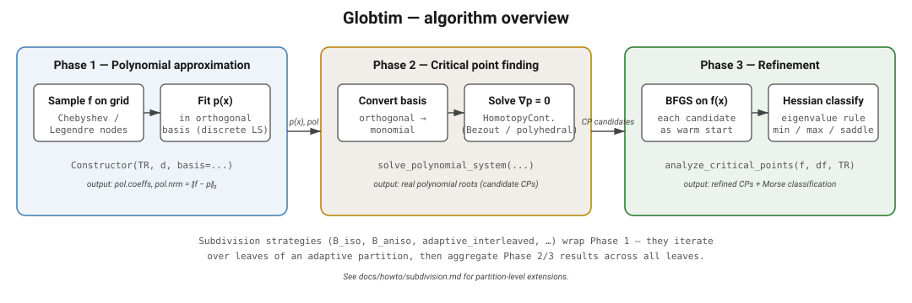

# Core Algorithm

Globtim's approach to global optimization consists of three main phases. This page shows the code for each; the mathematical statement of the method and of its guarantee is on [The Method](the_method.md).



Subdivision strategies (`:B_iso`, `:B_aniso`, `:adaptive_interleaved`, …) wrap Phase 1 — they iterate over leaves of an adaptive partition, then aggregate Phase 2/3 results across all leaves.

## 1. Polynomial Approximation

The first step constructs a polynomial approximation of the objective function using discrete least squares. For detailed coverage of approximation methods, see [Polynomial Approximation](polynomial_approximation.md).

### Sampling Strategy

Globtim uses tensorized Chebyshev or Legendre grids for function sampling:

```julia
# Create polynomial approximation
pol = Constructor(
    TR,                  # Test input specification
    degree;              # Polynomial degree
    basis = :chebyshev,  # Basis type (default; :legendre also supported)
)
```

The nodes of these grids cluster towards the faces of the box, which keeps the least-squares problem well conditioned as the degree grows (equispaced nodes do not: Runge's phenomenon).

### Approximation Quality

The `Constructor` returns a polynomial with an L2-norm error estimate:

```julia
pol = Constructor(TR, 8)
println("Approximation error: ", pol.nrm)

# Access polynomial coefficients
coeffs = pol.coeffs  # Coefficient matrix
```

The L2-norm can be computed using either Riemann sums or high-accuracy quadrature methods. For details on polynomial post-processing and sparsification, see [Polynomial Sparsification](sparsification.md).

### Basis Functions

Two basis types are supported:

- **Chebyshev polynomials** (default): orthogonal for the weight ∏ (1 − xᵢ²)^(−1/2), the measure of the capture theorem
- **Legendre polynomials**: orthogonal for the uniform weight on the box

## 2. Critical Point Finding

Once we have a polynomial approximation, we find all its critical points by solving:

∇p(x) = 0

where p(x) is our polynomial approximation.

### Polynomial System Setup

```julia
using DynamicPolynomials
using HomotopyContinuation  # provides the default :hc solver (weak-dependency extension)

# Define polynomial variables
@polyvar x[1:n_dims]

# Solve the system
solutions = solve_polynomial_system(
    x,          # Variables
    n_dims,     # Dimension
    degree,     # Polynomial degree
    pol.coeffs  # Coefficients
)
```

### Solver Options

Two solvers are available:

1. **[HomotopyContinuation.jl](https://www.juliahomotopycontinuation.org/)** (default): Numerical algebraic geometry solver (Breiding & Timme, 2018)

2. **[msolve](https://msolve.lip6.fr/)**: Symbolic solver based on Gröbner basis computations (Berthomieu, Eder & Safey El Din, 2021)

For detailed solver configuration and selection guidelines, see [Polynomial System Solvers](solvers.md).

### Solution Processing

Raw solutions are processed to extract valid critical points:

```julia
df = process_crit_pts(
    solutions,    # Raw solutions
    f,           # Original function
    TR,          # Domain specification
    solver="HC"  # Solver used
)
```

This function:
- Filters complex solutions
- Checks domain boundaries
- Evaluates function at each point
- Removes duplicates

## 3. Refinement and Classification

The critical points of the polynomial are candidates for critical points of `f`. The final phase refines each of them with a local method on `f` itself: Nelder–Mead in `analyze_critical_points` (the keyword names below keep a historical `bfgs_` prefix).

### Refinement

Each critical point is used as a starting point for local optimization:

```julia
df_enhanced, df_min = analyze_critical_points(
    f, df, TR,
    max_iters_in_optim=100,     # iterations of the local method
    bfgs_f_abstol=1e-8,        # Nelder–Mead stop: spread of f over the simplex
    tol_dist=0.025             # Clustering distance
)
```

### Convergence Tracking

The refinement process tracks:
- Number of iterations required
- Whether optimization converged
- Distance from initial to refined point
- Function value improvement

## Algorithm Parameters

### Polynomial Degree

For smooth functions, higher polynomial degrees generally improve approximation but increase cost.

### Domain Scaling

The `sample_range` parameter controls the search domain:
```julia
# Symmetric domain
TR = TestInput(f, dim=2, center=[0,0], sample_range=1.0)

# Asymmetric domain  
TR = TestInput(f, dim=2, center=[0,0], sample_range=[2.0, 1.0])
```

### Tolerance Settings

Key tolerances affecting results:
- `tol_dist`: Distance for clustering critical points (default: 0.025)
- `bfgs_f_abstol`: NelderMead's simplex-spread stop for refinement (default: 1e-8); `bfgs_g_tol` is refused, NelderMead has no gradient test
- `hessian_tol_zero`: Zero eigenvalue threshold (default: 1e-8)