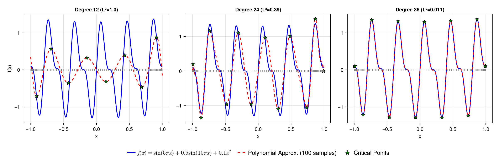
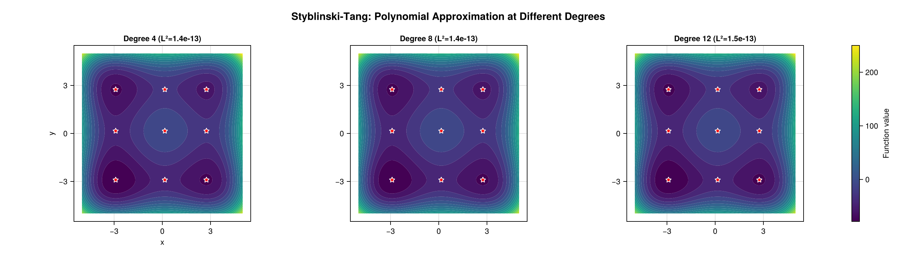

# Globtim.jl Documentation

[](https://julialang.org/downloads/)
[](https://github.com/gescholt/Globtim.jl/blob/main/LICENSE)

**Global optimization of continuous functions via polynomial approximation**

## The Problem

Finding all local minima of a continuous function over a bounded domain is fundamentally hard. Standard optimization algorithms (gradient descent, BFGS, etc.) find *one* local minimum from a given starting point — but how do you know there isn't a better one elsewhere?

## The Approach

Globtim solves this by replacing your function with a polynomial approximation. Why polynomials?

1. **Smooth functions are well-approximated by polynomials** — Chebyshev and Legendre bases provide well-conditioned polynomial approximations whose accuracy improves with degree for smooth functions
2. **Polynomial critical points can be enumerated** — Setting ∇p(x) = 0 gives a polynomial system which, generically, has finitely many solutions (at most (d−1)ⁿ for degree d in n variables, Bézout's bound); they can all be computed, numerically via homotopy continuation or symbolically
3. **Refinement on the original function** — Each polynomial critical point seeds a local method (Nelder–Mead by default; any local method can be used) on the original function, which can converge to a nearby true critical point

The result: a systematic search for local minima across the entire domain, not just the nearest one.

The method comes with a **global-capture guarantee**: for Morse functions on a compact domain, the local minimizers of the approximant lie within a target precision of *every* local minimizer of the function, with high probability, under an explicit trade-off between degree, number of samples and evaluation noise. [The Method](the_method.md) states the theorem, its hypotheses, and which steps of the package lie outside it; the proof is in the foundational paper — see [Citation](#Citation).

## Algorithm Overview

```
f(x)  -->  Polynomial p(x)  -->  Solve grad(p) = 0  -->  Refine on f(x)  -->  Verified critical points
           (Chebyshev/Legendre)   (HomotopyContinuation.jl)
```

### Challenging 1D function — multi-frequency oscillations at varying polynomial degrees:



### Styblinski-Tang 2D — classic test function with polynomial approximation:



For functions that vary on different scales in different regions, Globtim uses **adaptive subdivision** to build piecewise polynomial approximations that maintain accuracy everywhere.

## Installation

Requires Julia 1.12 or newer. Press `]` at the Julia prompt to enter Pkg mode
(backspace exits):

```julia
julia> ]
pkg> add Globtim HomotopyContinuation
```

`HomotopyContinuation` is a weak dependency loaded through a package extension, so it
installs separately. The default `:hc` solver stays unavailable until you
`using HomotopyContinuation` alongside Globtim — install it unless you plan to use
msolve instead.

### Additional Dependencies
- **Visualization**: `add CairoMakie` or `add GLMakie`
- **Exact solving**: Install [msolve](https://msolve.lip6.fr/) (symbolic method based on Groebner basis computations)

## Getting Started

For a detailed walkthrough, see [Getting Started](getting_started.md).

## Ecosystem

Globtim is the core of a family of packages spanning objective generation, optimization, analysis, and visualization. Each package's documentation lives in its repository (README + `docs/`); rendered documentation sites are being rolled out as the companion packages are registered.

| Package | Role | Documentation |
|:--------|:-----|:--------------|
| **Globtim** | Core: polynomial approximation + all-critical-point finding | you are here — [repo](https://github.com/gescholt/Globtim.jl) |
| **[DynamicObjectives](https://github.com/gescholt/DynamicObjectives.jl)** | ODE-based objective functions + model catalogue (inputs to Globtim) | [ODE Parameter Estimation](ode_parameter_estimation.md) (here) · [repo](https://github.com/gescholt/DynamicObjectives.jl) |
| **[GlobtimPostProcessing](https://github.com/gescholt/GlobtimPostProcessing.jl)** | Refinement, validation, parameter recovery, campaign analysis | [repo & docs](https://github.com/gescholt/GlobtimPostProcessing.jl) |
| **[GlobtimPlots](https://github.com/gescholt/GlobtimPlots.jl)** | Visualization (CairoMakie / GLMakie / WGLMakie) | [docs](https://gescholt.github.io/GlobtimPlots.jl/dev/) · [repo](https://github.com/gescholt/GlobtimPlots.jl) |

```
DynamicObjectives (objectives) --> Globtim (optimize) --> GlobtimPostProcessing (analyze) --> GlobtimPlots (visualize)
```

See the [Ecosystem Walkthrough](ecosystem_walkthrough.md) for one objective carried end-to-end across the family, and [ODE Parameter Estimation](ode_parameter_estimation.md) for the DynamicObjectives model catalogue documented in full here. GlobtimPostProcessing is registered; GlobtimPlots and DynamicObjectives install from their repositories until they are:
```julia
pkg> add GlobtimPostProcessing
pkg> add https://github.com/gescholt/GlobtimPlots.jl
pkg> add https://github.com/gescholt/DynamicObjectives.jl
```

## Citation

Globtim implements the algorithm introduced in:

> Safey El Din, M., Scholten, G., & Trélat, E. (2026). *Probabilistic algorithm for computing all local minimizers of Morse functions on a compact domain*. **Mathematics of Control, Signals, and Systems**. [doi:10.1007/s00498-026-00441-3](https://doi.org/10.1007/s00498-026-00441-3). Free access: [HAL hal-05160251](https://hal.sorbonne-universite.fr/hal-05160251v2).

If you use Globtim in your research, please cite this paper:

```bibtex
@article{safeyeldin2026probabilistic,
  author  = {Safey El Din, Mohab and Scholten, Georgy and Tr{\'e}lat, Emmanuel},
  title   = {Probabilistic algorithm for computing all local minimizers of {Morse} functions on a compact domain},
  journal = {Mathematics of Control, Signals, and Systems},
  year    = {2026},
  doi     = {10.1007/s00498-026-00441-3},
  note    = {Free access: HAL hal-05160251, https://hal.sorbonne-universite.fr/hal-05160251v2},
}
```
