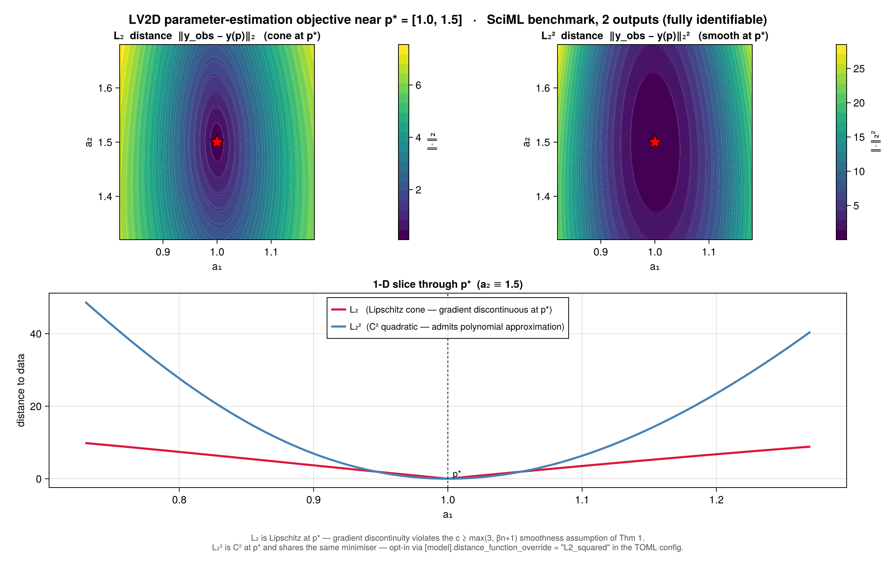

# ODE Parameter Estimation

Parameter estimation for dynamical systems is the workload that shaped much of
Globtim's design. Given a time series sampled from an ODE at unknown parameters,
recover the parameters by minimising the distance between the simulated and the
observed trajectories. The resulting landscape is expensive (every evaluation is an
ODE solve), frequently multimodal, and sometimes not even differentiable at its own
minimiser — which is what makes it a useful stress test for a polynomial-approximation
method.

The objectives themselves live in the companion package
[DynamicObjectives.jl](https://github.com/gescholt/DynamicObjectives.jl). They are
documented here, alongside Globtim, because the shape of these landscapes bears
directly on three Globtim topics: the smoothness hypothesis behind the global-capture
theorem (see [Core Algorithm](core_algorithm.md)), the choice of distance function, and
when adaptive subdivision is required rather than optional.

## The problem

Standard optimizers find *one* local minimum from a given start. For ODE fitting that
is rarely enough: the objective can have many basins, symmetry-induced duplicate
minimisers (from parameters that are only *locally* identifiable), and whole regions
where the solver diverges. Globtim's question — *what are all the local minimisers on
this box?* — is the question parameter estimation actually asks, since a
non-identifiable model has a set of equally good answers and you want the whole set.

## What DynamicObjectives provides

**29 benchmark ODE models**, each of which:

1. **Defines an ODE system** — symbolic representation via ModelingToolkit.jl
2. **Generates synthetic data** — a time series from true parameters, optional noise
3. **Creates an objective function** — the error between simulated and reference trajectories
4. **Handles failures gracefully** — returns `Inf` on solver failure, so optimization never throws

| Difficulty | Models | Parameters |
|------------|--------|------------|
| Easy | Lotka-Volterra 2D (v1, v2, v3, 2-output, SciML) | 2 params |
| Medium | LV 3D/4D, DAISY, FHN 2-out, Goodwin 3D, RMA, LV2D reparam | 3-4 params |
| Medium-Hard | LV 4D Constrained, Simple 1D, Coupled LV2D | 1-4 params |
| Hard | FHN, Goodwin 4D, Lorenz, Rossler, identifiability tests | 1-4 params |
| Very Hard | Generalized Lotka-Volterra 4D | 20 params |

[Model Catalog](model_catalog.md) has the full table: function names, state and output
counts, system type, and which models need a solver timeout.

### Robust error handling

- **Returns `Inf` on failure** — no exceptions escape into the optimizer
- **Timeout mechanism** — keeps a stiff or diverging solve from stalling a grid sweep
- **Multiple distance metrics** — L1, L2, log-L2 norms

### Flexible data generation

- **Synthetic time series** with configurable sampling
- **Optional noise injection** for robustness testing
- **Full or partial observability** — 1–4 measured outputs

### Display infrastructure

Readable output for models, parameters, and results:

```julia
display_model_summary(model)
display_parameters(param_names, values)
display_time_series(data)
```

## Installation

DynamicObjectives is not registered; install it from its repository alongside Globtim:

```julia
pkg> add Globtim HomotopyContinuation
pkg> add https://github.com/gescholt/DynamicObjectives.jl
```

For development against a local checkout:

```julia
using Pkg
Pkg.develop(path = "/path/to/DynamicObjectives")
```

Or, as a path source in a `Project.toml`:

```toml
[deps]
DynamicObjectives = "a7860e71-583f-4874-99b9-9df52d7a8e5c"

[sources]
DynamicObjectives = {path = "../DynamicObjectives"}
```

## Quick start

```julia
using DynamicObjectives

# 1. Define an ODE system
model, params, states, outputs = define_lotka_volterra_2D_model_v3()

# 2. Set up the parameter estimation problem
p_true = [1.0, 1.0]
ic = [1.0, 1.0]
time_interval = [0.0, 10.0]
numpoints = 25

# 3. Create objective function
error_func = make_error_distance(
    model, outputs, ic, p_true, time_interval, numpoints,
    L2_norm, first, nothing;
    return_inf_on_error = true,
    eval_timeout = 10.0
)

# 4. Test at true parameters
@assert error_func(p_true) < 1e-6  # Should be ~0
```

`error_func` is an ordinary `Vector{Float64} -> Float64` callable, so it drops straight
into the Globtim workflow of [Getting Started](getting_started.md) in place of a
hand-written objective.

!!! warning "Check the objective at `p_true` first"
    Because a misconfigured objective returns `Inf` rather than throwing, it is possible
    to optimize a function that is `Inf` everywhere and get a plausible-looking result.
    Assert `isfinite(error_func(p_true))` before running anything expensive.

## Distance metrics: L₂ vs L₂²

The choice of distance function shapes the landscape near `p_true`. The default
`L2_norm` is **Lipschitz but not differentiable at the minimum** (a cone, so the
gradient jumps); switching to `L2_squared` gives a **C² quadratic basin** at the same
minimiser.



The 1-D slice (bottom) makes the distinction sharp: `L2_norm` is V-shaped at `p*`,
while `L2_squared` is U-shaped. This matters for Globtim's approximation guarantee —
Thm 1 requires `c ≥ max(3, βn+1)` continuous derivatives of the objective, which
`L2_norm` violates at the minimum and `L2_squared` satisfies.

Opt in per experiment via the TOML config:

```toml
[model]
distance_function_override = "L2_squared"
```

Available metrics: `L2_norm` (default), `L2_squared`, `log_L2_norm`. The figure was
generated by `examples/figures/l2_vs_l2squared.jl` in the DynamicObjectives repository.

## Contents

- [Model Catalog](model_catalog.md) — all 29 models with configurations and recommended testing sequences
- [Glued Objectives](glued_objectives.md) — higher-dimensional test problems with *known* critical-point sets, via Cartesian-product gluing

The docstring-level API reference for DynamicObjectives lives on that package's own
site: [DynamicObjectives.jl API Reference](https://gescholt.github.io/DynamicObjectives.jl/api.html).
